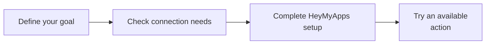

# Plan an account-information setup review without placing trades

**Public + your AI assistant · powered by HeyMyApps**

You want an account-information setup review without placing trades, but first need to establish what Public's API can support and what is ready in your account.

**Made for:** Teams inspecting a brokerage API integration

This is an **independent** integration built on [Public's published API](https://github.com/PublicDotCom/public-openapi). It is not an official Public product or partnership.

This is a setup helper. You will need HeyMyApps and a Public connection in HeyMyApps to complete setup.

## Ask your AI to set this up

Paste this into a coding assistant that can open project files and run commands, such as Codex, Claude Code or Grok Build. You do not need to understand the code first.

```text
Help me use this project: https://github.com/jannikco/public-mcp

I'm not a programmer. My goal is: Plan an account-information setup review without placing
trades.

Read the project instructions and set it up in a new folder without overwriting my work.
Guide me through HeyMyApps and its private key setup; never ask me to paste secrets into this
chat. Start with the documented setup plan and explain what is still needed to connect my
app. Explain the result in plain English. Ask before changing records, sending messages or
publishing anything.
```

## Three useful things to ask for

```text
Help me plan an account-information setup review without placing trades with Public.
Explain the setup steps in plain English.
```

```text
Compare that goal with the linked Public API documentation. Tell me whether an import,
account details or manual setup is still needed.
```

```text
Check which suitable actions are actually available in my HeyMyApps account. If none are
ready, stop with a missing-step checklist instead of pretending the business task has run.
```

## Your path to a real result



1. [Open the connection guide](https://heymyapps.com/github/start?app=public&integration=public-mcp&utm_source=github&utm_campaign=github-public-mcp&utm_content=people-first-readme) and connect your Public API secret key in HeyMyApps only — not in this repo, chat or package env.
2. Let your AI explain the required HeyMyApps account and Public API permissions.
3. Run the documented setup check. A successful check is not proof that provider actions ran.

**What to expect:** You get a setup plan and connection checks. The hosted integration exposes **25 read tools by default** (accounts, portfolio, history, tax lots including CSV export, instruments, bond search and details, quotes, options expirations, chain, greeks, strategy quotes, price bars, event contracts, order lookup and search, and two order preflight checks). **Four trading tools** (`place_order`, `place_multileg_order`, `replace_order`, `cancel_order`) are **off by default**; when enabled, each call requires confirmation in HeyMyApps (**Executions → Pending approvals**). This bridge never auto-approves.

Trading through Public uses real money. Investing involves risk, including the loss of your investment. Options and multi-leg strategies are high risk, and some can lose more than the amount invested. HeyMyApps does not give investment advice. Read Public's disclosures: https://public.com/disclosures

Add your HeyMyApps key privately in your project settings (`HEYMYAPPS_API_KEY`; `PIPMCP_API_KEY` still works). Keep keys out of chat and public repositories. Your **Public API secret key** is entered in HeyMyApps only — never in this repository, chat or the environment of this package.

## Keep going

- [Public on HeyMyApps](https://heymyapps.com/connect/public)
- [Find another useful integration](https://github.com/jannikco/pipmcp-connectors)
- [Connect an API you control](https://github.com/jannikco/openapi-to-mcp)
- [Try the GitHub project](https://github.com/jannikco/github-mcp)

<details>
<summary>Technical reference: installation commands, exact capabilities and troubleshooting</summary>

<!-- people-first:technical:start -->
# Public MCP setup and connection checker

**Prepare Public for AI workflows with a HeyMyApps setup doctor, agent instructions and authenticated connector discovery.**

[Activate with HeyMyApps](https://heymyapps.com/github/start?app=public&integration=public-mcp&utm_source=github&utm_campaign=github-public-mcp) · [Integration directory](https://heymyapps.com/connect/public)

## Build something useful

Prepare Public and inspect your hosted setup.

This repository is a setup utility. Availability depends on your actual hosted integration and connection. Provenance: [Public OpenAPI spec](https://github.com/PublicDotCom/public-openapi/blob/main/spec.yaml).

## Quick start

Requires Node.js 22+. Clone this repository, then:

```sh
npm ci --ignore-scripts
npm test
npm start
# After configuring Public in HeyMyApps and setting HEYMYAPPS_API_KEY:
npm start -- --live
# Launch the stdio MCP bridge:
npm run server
```

Create a HeyMyApps API key with explicit `connectors:read` and `connectors:call` scopes. Set `HEYMYAPPS_API_KEY` in the calling process environment (`PIPMCP_API_KEY` is accepted as an alias). **Public API credentials are configured only in HeyMyApps** — this package does not accept or store them. Multiple accounts require explicit `HEYMYAPPS_INTEGRATION_ID` and `HEYMYAPPS_CONNECTION_ID` from discovery (aliases: `PIPMCP_INTEGRATION_ID`, `PIPMCP_CONNECTION_ID`, `PIPMCP_CONNECTOR_ID`). Existing keys do not gain scopes automatically.

## Built for coding agents

Install this repository's skill into your project:

```sh
node lib/cli.mjs agents install --client codex --scope project --project /path/to/project
# Use claude or grok for those clients.
# Optional: --skill heymyapps-public
```

Connect AI agents to Public using one HeyMyApps API key and actual hosted tool discovery. Native AGENTS.md, CLAUDE.md and project skills support the current coding session. No additional AI model key is required. [capabilities.json](capabilities.json) describes the package; [llms.txt](llms.txt) indexes its instructions.

## Default tool inventory

Authenticated discovery uses `GET https://heymyapps.com/api/v1/connectors/public/tools` (401 without a key is expected). The hosted connector publishes these tools by default unless your workspace policy differs.

**Read tools (on by default):** `get_accounts`, `get_account_portfolio_v2`, `get_history`, `get_unrealized_tax_lots`, `get_unrealized_tax_lots_csv`, `get_unrealized_tax_lots_for_symbol`, `get_all_instruments`, `get_instrument`, `search_bonds`, `get_bond_details`, `get_quotes`, `get_option_expirations`, `get_option_chain`, `get_option_greeks`, `get_strategy_quote`, `get_bars_v2`, `get_bars_v2_with_aggregation`, `get_event_details`, `get_event_summary`, `get_event_categories`, `get_event_contract_bars`, `get_order`, `search_orders`, `preflight_single_leg`, `preflight_multi_leg`.

**Trading tools (off by default; confirmation required when enabled):** `place_order`, `place_multileg_order`, `replace_order`, `cancel_order`. Every trading call asks for approval in HeyMyApps (Executions → Pending approvals). The bridge never auto-approves.

Trading through Public uses real money. Investing involves risk, including the loss of your investment. Options and multi-leg strategies are high risk, and some can lose more than the amount invested. HeyMyApps does not give investment advice. Read Public's disclosures: https://public.com/disclosures

## Inspect actual tools before calling

```js
import {HeyMyAppsGatewayClient} from './lib/index.mjs';
const client = new HeyMyAppsGatewayClient(); // HEYMYAPPS_API_KEY or PIPMCP_API_KEY
const inventory = await client.getTools('public');
console.log(inventory.data.tools);
// Select a real tool and validate your arguments against its returned schema.
// client.callTool('public', actualToolName, reviewedArguments, {idempotencyKey});
```

`PipMCPGatewayClient` remains exported for compatibility. HeyMyApps enforces workspace, role, connection, policy/approval and usage controls. Preserve the original idempotency key when retrieving/resuming a receipt. Pending and confirmation_required are not completed provider results; uncertain writes are held for reconciliation. The bridge never auto-approves a hosted action.

## Version 1

This release uses the authenticated HeyMyApps gateway at `https://heymyapps.com/api/v1` for discovery and execution. Configure `HEYMYAPPS_API_KEY` before reconnecting.

## Evidence and support

Transport, package and agent fixtures are tested. Authentication and Public API access must be checked in your own configured workspace; synthetic fixtures do not establish live provider execution. Do not include credentials or customer records in public issues. MIT covers this public client.

## Use a manually imported API

If Public is not already available in your workspace, import your reviewed API definition, publish the selected tools and configure its connection in HeyMyApps. Set `HEYMYAPPS_CONNECTOR_ID=custom-api` together with `HEYMYAPPS_INTEGRATION_ID` and, when needed, `HEYMYAPPS_CONNECTION_ID` (or the `PIPMCP_*` aliases). Then run `npm run doctor` or `npm run server`. Leaving `HEYMYAPPS_CONNECTOR_ID` unset uses `public`. Importing requires `integrations:read` and `integrations:write` on the same key; discovery and calls use `connectors:read` and `connectors:call`.

## Provider setup reference

[Public API quickstart](https://public.com/api/docs/quickstart). [OpenAPI spec](https://github.com/PublicDotCom/public-openapi/blob/main/spec.yaml). Public credentials are entered in HeyMyApps only; this package does not accept or store provider secrets.

This is an independent integration built on Public's published API — not an official Public partnership.

<!-- people-first:technical:end -->

</details>